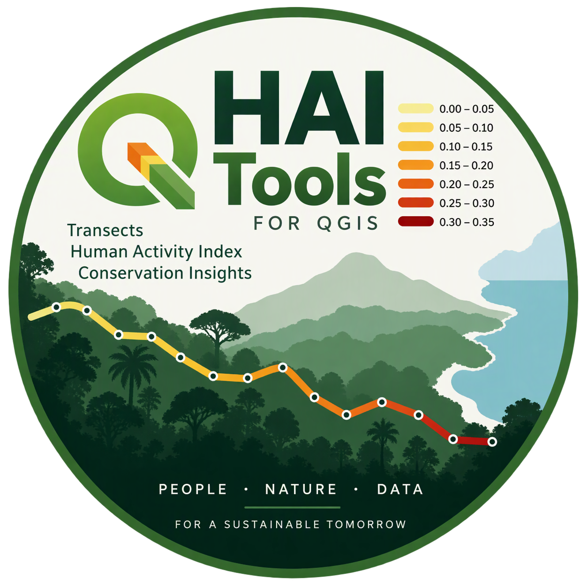

<p align="center">
  
</p>

<h1 align="center">HAI Tools for QGIS</h1>

<p align="center">
  QGIS Processing tools for preparing environmental monitoring transects and mapping the Human Activity Index (HAI).
</p>

<p align="center">
  <a href="https://doi.org/10.5281/zenodo.23925304"></a>
  
  
  
  
  
</p>

> **Version:** 0.3.1  
> **Compatibility:** QGIS 4.x, Qt6 and Python 3

## Overview

**HAI Tools** is an experimental QGIS Processing plugin for preparing environmental monitoring transects and mapping the **Human Activity Index (HAI)**.

The plugin was developed around point observations collected along monitoring transects and provides tools to reconstruct attributed line segments, aggregate existing HAI values into nominal 500 m units, and apply a consistent HAI map style.

## Processing tools

### 1. Points to Attributed Segments

Converts ordered monitoring points into individual line segments while preserving source attributes.

Default fields:

- Transect: `Percurso`
- Year: `Ano`
- Campaign: `Epoca`
- Sequence: `Seccao`
- Point identifier: `GPS`
- HAI: `HAI`

### 2. HAI in 500 m Transect Blocks

Creates nominal 500 m blocks from five consecutive 100 m links and combines repeated monitoring campaigns according to the current working aggregation workflow.

> **Methodological note:** the 500 m aggregation remains a working interpretation pending independent verification of the original HAI protocol.

### 3. Apply HAI Symbology

Applies the standard rule-based HAI classification to any line layer containing an HAI field.

Default line width: **1.0 mm**.

## HAI classification

| HAI | Class |
|---|---|
| 0.00–0.05 | Very low |
| >0.05–0.10 | Low |
| >0.10–0.15 | Moderate-low |
| >0.15–0.20 | Moderate |
| >0.20–0.25 | Moderate-high |
| >0.25–0.30 | High |
| >0.30 | Very high |

NULL values remain a separate renderer rule but use the first yellow colour to preserve visual continuity along the transect.

## Installation

1. Download `HAI_Tools_0.3.1.zip` from the GitHub **Releases** page.
2. In QGIS, open **Plugins > Manage and Install Plugins > Install from ZIP**.
3. Select the downloaded ZIP and enable **HAI Tools**.
4. Open **Processing Toolbox > HAI Tools**.

No third-party Python dependencies are required.

## Repository structure

```text
qgis-hai-tools/
├── HAI_Tools/
│   ├── __init__.py
│   ├── plugin.py
│   ├── provider.py
│   ├── metadata.txt
│   └── algorithms/
│       ├── __init__.py
│       ├── common.py
│       ├── points_to_segments.py
│       ├── hai_500m.py
│       └── apply_hai_symbology.py
├── assets/
│   └── hai-tools-logo.png
├── .gitignore
├── README.md
├── CHANGELOG.md
├── CITATION.cff
└── LICENSE
```

## Methodological status

HAI Tools currently operates on an **existing HAI field**. Direct calculation of HAI from raw human-activity observations is not implemented until the original formulation is independently verified.

The current 500 m workflow should be considered experimental and validated before use in scientific publication or conservation decision-making.

## Citation

The first archived public release has DOI **10.5281/zenodo.23925304**.

For reproducible research, cite the exact software version used in the analysis. Machine-readable citation metadata are available in `CITATION.cff`.

## License

HAI Tools is released under the **GNU General Public License v3.0**.

## Author

**Pedro Goncalves**
